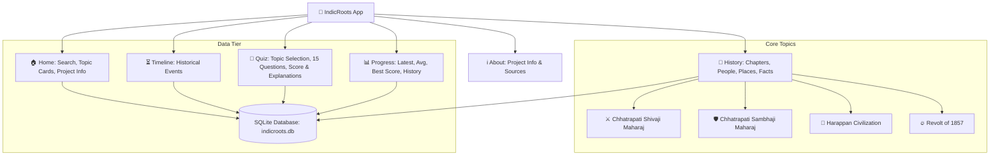
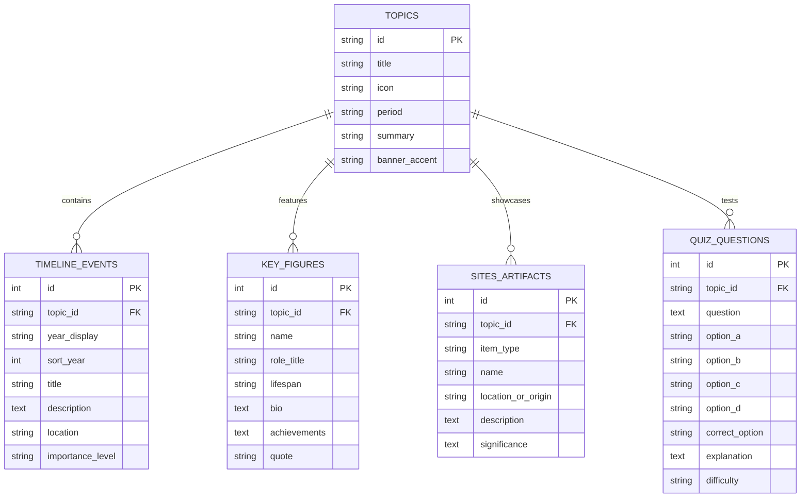

# 🪷 IndicRoots

> **Interactive Indian Heritage & History Knowledge Platform**  
> Built with **Python**, **Streamlit**, and **SQLite**. Zero login barriers, no heavy frameworks, fast local-first architecture.

---

## 📖 Executive Summary & Vision

**IndicRoots** is an immersive digital chronicle designed to bring pivotal chapters of Indian history to life. Built with a clean Streamlit interface and enriched with heritage-inspired aesthetics, it allows students, history enthusiasts, and curious readers to explore historical narratives, inspect timelines, discover archaeological/military artifacts, and test their knowledge interactively.

### 🗺️ Application Architecture & Navigation Hierarchy

```
Home
 ├── Search
 ├── Topic cards
 └── Project information

History
 ├── Select topic
 ├── Chapters
 ├── People
 ├── Places
 └── Facts

Timeline
 └── Historical events

Quiz
 ├── Select topic
 ├── 15 questions
 ├── Score
 └── Answer explanations

Progress
 ├── Latest score
 ├── Average score
 ├── Best score
 └── Quiz history

About
 └── Project information
```



---

## 🛠️ Technical Stack & Architectural Principles

| Component | Choice | Rationale |
| :--- | :--- | :--- |
| **Core Language** | Python 3.13+ | Rapid development, native data handling, zero compilation overhead. |
| **Frontend & UI** | Streamlit 1.59+ | Native interactive widgets, session state management, responsive grid layouts. |
| **Data Storage** | SQLite 3 (`indicroots.db`) | Zero configuration, file-based, preloaded with rich curated historical records. |
| **Aesthetic Layer** | Modular CSS (`style.css`) | Custom Indian heritage styling (royal saffron, antique gold, deep obsidian, terracotta). |
| **Dependencies** | Minimal standard set | `streamlit`, `sqlite3` (built-in standard library). No external heavy APIs. |

### Strict Non-Functional Constraints
- ❌ **No React / Vue / Angular / JS Frameworks**
- ❌ **No Flask / Django / FastAPI server bloat**
- ❌ **No External Auth / Login / Registration**
- ❌ **No Paid APIs or Rate-Limited External Endpoints**
- ✅ **100% Offline-Ready Local Performance**

---

## 🏛️ Deep Content Curricula & Modules

### ⚔️ Topic 1: Chhatrapati Shivaji Maharaj (1630–1680)
*The Father of Hindavi Swarajya & Visionary Strategist*
- **The Genesis & Oath**: Raireshwar temple pledge (1645) at age 15; capture of Torna and Kondhana.
- **Masterclass Guerrilla Warfare (*Ganimi Kawa*)**: Topography exploitation, Pratapgad battle & Afzal Khan encounter, tactical Panhala escape (Baji Prabhu Deshpande's sacrifice at Pavan Khind), Lal Mahal raid on Shaista Khan.
- **Naval Empire & Maritime Defense**: Construction of sea forts (Sindhudurg, Vijaydurg, Suvarnadurg); founding the Maratha Navy.
- **Governance & Coronation (1674)**: *Rajyabhisheka* at Raigad, creation of *Ashta Pradhan* council, abolition of hereditary land-tax abuses, respect for places of worship across faiths.

### 🛡️ Topic 2: Chhatrapati Sambhaji Maharaj (1657–1689)
*The Undefeated Warrior-King & Polymath Scholar*
- **Invictus Military Record**: Over 120 battles fought without a single military defeat against the Mughal Empire, Siddis of Janjira, and Portuguese Goa.
- **The Goa Campaign (1683)**: Counter-offensive forcing the Portuguese Viceroy near total capitulation across Alorna, Chapora, and Santo Estevão.
- **Literary & Scholarly Mastery**: Fluency in Sanskrit, Marathi, Brajbhasha; authored *Budhabhushanam* (treatise on statecraft, polity, and warfare), *Nakhshikh*, and *Nayikabhed*.
- **The Supreme Sacrifice (Tulapur, 1689)**: Unshakable defiance during weeks of torture under Aurangzeb; refused conversion or surrender of Swarajya forts, etching his legacy as *Dharmaveer*.

### 🏺 Topic 3: Harappan Civilization (Indus-Saraswati) (c. 3300–1300 BCE)
*The Pinnacle of Bronze Age Urban Planning & Sanitary Engineering*
- **Urban Planning Marvels**: North-South/East-West grid systems, burnt-brick standard ratios (4:2:1), subterranean covered drainage, multi-story residences.
- **Iconic Sites**:
  - *Mohenjo-daro*: The Great Bath, Great Granary, Bronze Dancing Girl, Priest-King bust.
  - *Lothal*: The world's earliest known tidal dockyard, international bead factory, trade links to Mesopotamia.
  - *Dholavira*: Seven-tier stone water reservoirs, stadium, monumental 10-character signboard.
  - *Kalibangan & Rakhigarhi*: Ploughed field furrow marks, fire altars, expansive necropolises.
- **Trade, Weights & Seals**: Cubical chert weights, steatite Pashupati and Unicorn seals, lapis lazuli and carnelian craftsmanship.
- **Mysteries & Theories**: Undeciphered script, shifting river courses (Saraswati/Ghaggar-Hakra drying), environmental adaptation.

### 🔥 Topic 4: Revolt of 1857 (India's First War of Independence)
*The Spark, the Resistance, and the Shattering of East India Company Rule*
- **Catalysts**: Doctrine of Lapse (Lord Dalhousie), exploitation of peasantry, Enfield P-53 greased cartridge trigger.
- **Outbreak & Timeline**:
  - 29 March 1857: Mangal Pandey's defiance at Barrackpore.
  - 10 May 1857: Sepoy rising at Meerut and march to the Red Fort, Delhi.
- **Leaders & Theatres of Conflict**:
  - *Rani Lakshmibai of Jhansi*: "Meri Jhansi nahi doongi", heroic defense and battlefield martyrdom at Kotah-ki-Serai (Gwalior).
  - *Nana Saheb & Tatya Tope*: Guerrilla tactics across central India and the Bundelkhand plateau.
  - *Begum Hazrat Mahal*: Defense of the Residency in Lucknow and leadership of Awadh.
  - *Veer Kunwar Singh*: 80-year-old warlord of Jagdishpur (Bihar) who routed British forces across the Ganga.
  - *Bahadur Shah Zafar*: The reluctant symbolic emperor, exiled to Rangoon.
- **Historical Transformation**: Dissolution of British East India Company; transfer of rule to the British Crown (Queen's Proclamation of 1858); birth of modern Indian nationalism.

---

## 🗄️ SQLite Database Architecture

A single lightweight SQLite database (`indicroots.db`) containing indexed, relational tables:



---

## 🎨 UI/UX Design System & Heritage Aesthetic

The interface features an **Indian Heritage Aesthetic** blending regal historical motifs with modern responsive readability:

- **Color Palette**:
  - **Imperial Saffron / Kesari**: `#E06D14` & `#F58220` (Primary accent & headers)
  - **Antique Temple Gold**: `#D4AF37` & `#FFD700` (Badges, dates, borders)
  - **Mahogany / Terracotta**: `#8C2D19` & `#B33927` (Card highlights & callouts)
  - **Midnight Obsidian**: `#121217` & `#1C1C24` (Background & card surfaces)
  - **Warm Parchment**: `#F5EFEB` & `#E2D9D0` (High-contrast typography)
- **Visual Elements**:
  - Glass-morphic info cards with thin gold borders (`border: 1px solid rgba(212, 175, 55, 0.25)`).
  - Chronology vertical milestone badges.
  - Interactive quiz response feedback with smooth explanation reveals.
  - Filterable tabs, search bar, and metric stat counters.

---

## 📁 Project Directory Structure

```
INDICROOTS3/
├── README.md                   # Project documentation & build plan
├── app.py                      # Main Streamlit entrance & navigation coordinator
├── config.py                   # Global constants, color themes, and page metadata
├── db.py                       # SQLite connection helpers, query utilities, and DAO
├── init_db.py                  # Seed script: initializes tables and loads rich historical data
├── indicroots.db               # SQLite database with complete historical datasets
├── static/
│   └── style.css               # Heritage styling: cards, badges, timelines, hero banner
└── views/
    ├── home.py                 # Home: Search, Topic cards, Project information
    ├── history.py              # History: Topic selector, Chapters, People, Places, Facts
    ├── timeline.py             # Timeline: Historical events
    ├── quiz.py                 # Quiz: Topic selector, 15 questions, Score, Explanations
    ├── progress.py             # Progress: Latest, Average, Best score, Quiz history
    └── about.py                # About: Project information, Sources & Methodology
```

---

## 🚀 Getting Started

### Prerequisites
- Python 3.10+ (tested with Python 3.13+)
- Streamlit

```bash
pip install streamlit
```

### Running the Application

1. Initialize database:
   ```bash
   python init_db.py
   ```
2. Launch Streamlit:
   ```bash
   streamlit run app.py
   ```
